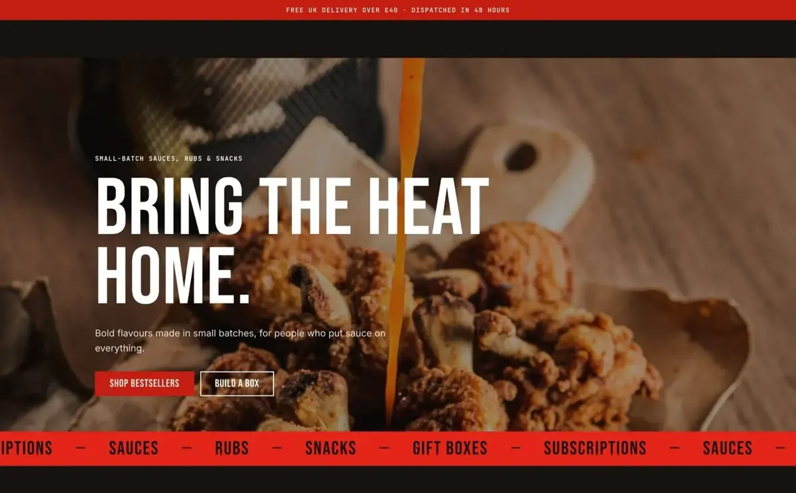
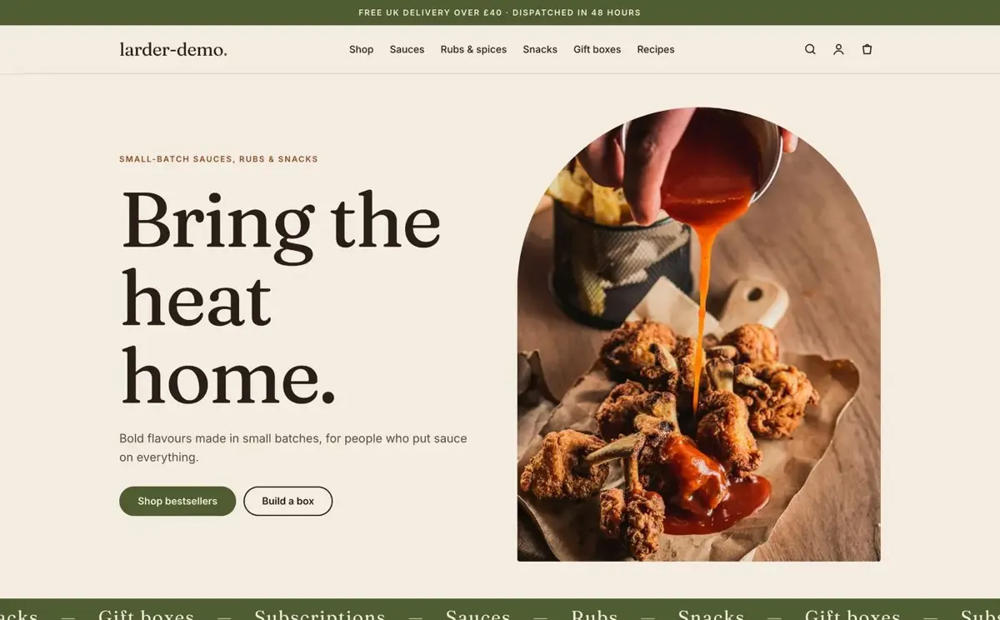
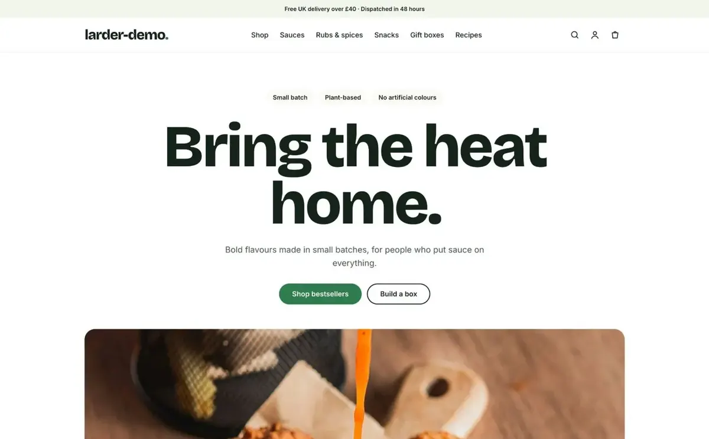

# Larder – free Shopify theme for food shops

Larder is a free Shopify Online Store 2.0 theme for people who sell food online: bakeries, delis, hot sauce and pantry brands, coffee roasters, street food kitchens and meal kit businesses. It has three styles in one theme (Street, Artisan and Fresh) and needs no paid apps for its core features.

**[Live demo](https://larder-demo-8yvpfsby.myshopify.com)** (password: `larder`) · **[Download and docs](https://rawcode.online/free-shopify-themes/larder/)** · Made by **[Rawcode](https://rawcode.online)**

| Street | Artisan | Fresh |
| --- | --- | --- |
|  |  |  |
| Dark, loud and condensed. Hot sauce, burgers, street food. | Warm serif and cream tones. Bakeries, delis, small-batch makers. | Light, clean and rounded. Meal kits, grocers, healthy brands. |

## Features

**Made for food**
- Dietary labels (Vegan, Gluten free…) on cards and product pages, plus a diet filter
- Heat scale, calories, protein, weight, nutrition table, ingredients and allergens from product metafields
- Order cut-off countdown: "Order within 2h 15m for dispatch today", with pickup and delivery lines
- Subscription-ready buy box for weekly boxes and refills
- Menu section for cafés and restaurants, with prices and dietary labels
- Opening hours and location section with map and directions, plus an opening hours footer block

**Built to sell**
- Quick view and quick add from collection pages, including products with options
- Three filter layouts (sidebar, horizontal bar, drawer), a mobile filter panel with live result count, and one-tap filter pills
- Slide-out cart with a free delivery progress bar
- Predictive search with images and prices
- Full customer account pages

## Install

1. Download this repository as a zip (**Code → Download ZIP**), or get the ready-made package from [rawcode.online](https://rawcode.online/free-shopify-themes/larder/).
2. In Shopify admin open **Online Store → Themes → Add theme → Upload zip file**.
3. Click **Customize**, open **Theme settings → Style** and pick Street, Artisan or Fresh.
4. Publish.

You can also connect this repository to your store with Shopify's GitHub integration (**Add theme → Connect from GitHub**).

## Food details

Larder reads product metafields in the `larder` namespace. Create them in **Settings → Custom data → Products**. Empty fields stay hidden.

| Metafield | Type | Shows |
| --- | --- | --- |
| `larder.dietary` | List of single line text | Diet labels and the diet filter |
| `larder.heat_level` | Integer 1–5 | Chilli scale |
| `larder.kcal` | Integer | Calories |
| `larder.protein` | Integer (grams) | Protein |
| `larder.weight` | Single line text | Weight label |
| `larder.badge` | Single line text | Corner badge on the card image |
| `larder.nutrition` | Multi-line text | Nutrition table, one row per line (`Fat: 12g`) |
| `larder.ingredients` | Multi-line text | Ingredients tab |
| `larder.allergens` | Multi-line text | Allergens tab |

For a diet filter, install the free **Search & Discovery** app and add `larder.dietary` as a filter.

Full documentation: [rawcode.online/free-shopify-themes/larder](https://rawcode.online/free-shopify-themes/larder/)

## Licence

Free for your own and client stores, including commercial ones, as long as the "Theme by Rawcode" footer credit stays visible. Reselling or redistributing the theme is not allowed. A white-label licence (99 EUR per store, non-refundable) removes the credit requirement. See [LICENSE.txt](LICENSE.txt).

## Questions and help

- Questions and ideas: [Discussions](https://github.com/garysquatter/larder/discussions)
- Bugs: [Issues](https://github.com/garysquatter/larder/issues)
- Store setup, migration from WooCommerce or Squarespace, custom sections: [hello@rawcode.online](mailto:hello@rawcode.online)
